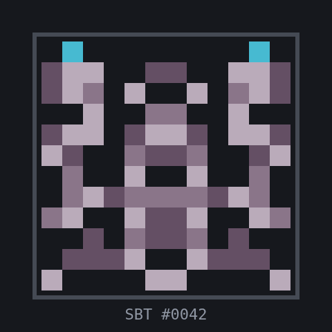
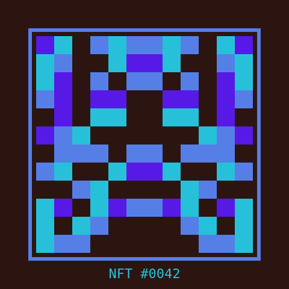

# Metadata — Ryodan Keys v6

V6 has 6,666 token IDs, **1 through 6666** (`FIRST_TOKEN_ID = 1`; key #0042 is token 42): 6,000 paid + 666 treasury, assigned in one sequence across paid and treasury mints. Phases, tiers and Pioneer pairs do not create separate ID ranges or choose artwork.

## Two sets, fixed at deploy

The constructor takes two base URIs, both ending with `/` and immutable afterwards:

- `sbtBaseURI`: the locked key (soulbound, wireframe artwork);
- `nftBaseURI`: the unlocked key (transferable NFT).

`tokenURI(id)` is `<base><id>.json` without padding, with `nftBaseURI` when the collection sold out or the key was kept (`kept(id)`), otherwise `sbtBaseURI`:

```text
tokenURI(1)    = <sbtBaseURI>1.json      while locked
tokenURI(6666) = <nftBaseURI>6666.json   after sellout
```

There is **no reveal transaction** and no setter for either URI. Burned and never-minted IDs have no URI.

## Prepare the files

1. Prepare two sets of 6,666 JSON files each, named `1.json` through `6666.json` without padding. Include standard fields such as `name`, `description`, `image` and `attributes`.
2. Upload/pin both directories before deploying. Test exact paths for IDs 1 and 6666 and validate every intermediate file, not only those two. Keep durable backups and pinning coverage.
3. Pass both directory URIs, each ending with `/`, to the deploy (`deploy.mjs` requires them outside local Anvil). A wrong URI cannot be corrected after deploy.

## When a key switches

- **Sellout:** the mint that completes all 6,666 keys (6,000 paid + 666 treasury) emits ERC-4906 `BatchMetadataUpdate(1, 6666)`; every key reads the NFT set from then on.
- **Kept key after an unsuccessful sale:** `settle` emits `MetadataUpdate(id)` for each kept key; only those keys read the NFT set.

Marketplace refresh timing is external to the contract. There is no shuffle, VRF or provenance commitment: the ID-to-file mapping is the deterministic numbering above.

## Verification

Both sets, the switch at sellout (keys 1 and 6666) and the switch of a kept key are covered by Solidity tests (`RyodanKeys.t.sol`, `KeepOrRefund.t.sol`, `RadixV6.t.sol`); the console browser test on Anvil checks that key 6666 reads the NFT set after the full 6,666-key sale. The Sepolia v6 test deployment uses random pixel-art placeholders from `metadata-test/server.js` ([ryodan-meta.grooooog.space](https://ryodan-meta.grooooog.space)); examples for key 42:

| SBT set (locked) | NFT set (unlocked) |
| --- | --- |
|  |  |
